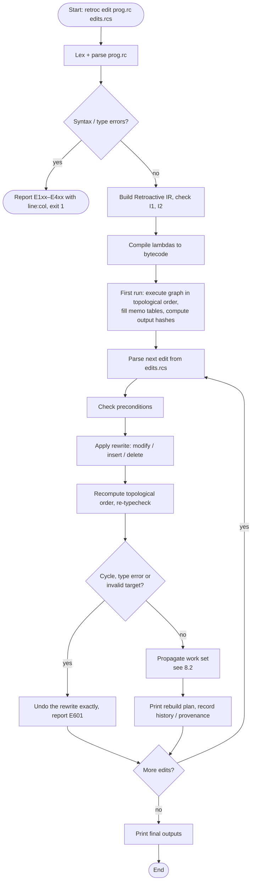
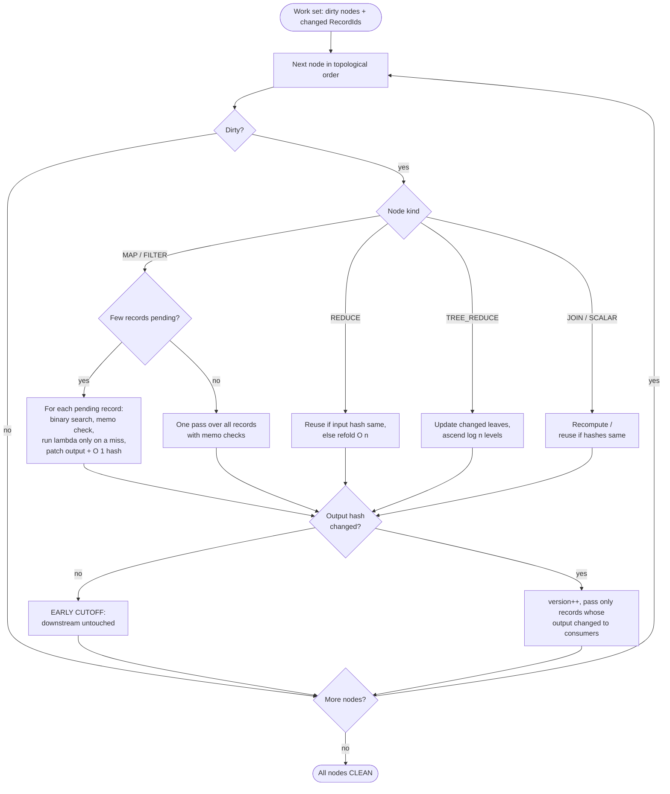

# RetroC: A Compiler and Runtime for Retroactively Editable Dataflow Pipelines

**Final Project Report**
Repository: `RetroC` · Language: C++17 · Build: CMake · Date: 28 October 2026

> **Abstract.** Data pipelines are routinely edited after they have run: a bad input record is corrected, a missing cleaning step is added in the middle, or an unneeded stage is removed. The usual answer is to rerun the whole pipeline. RetroC is a compiler and runtime for a small, pure dataflow language in which these three edits — *modify an input record*, *insert a stage*, *delete a stage* — are first-class operations on a versioned dataflow graph (the *Retroactive IR*). After an edit, RetroC recomputes only the records whose inputs actually changed, using per-record memo tables, an O(1)-updatable collection hash and early cutoff. Every result is guaranteed to equal a full rerun of the edited program. Measured with a 3-warm-up / median-of-11 protocol, a single-record edit runs **9.6–10× faster than a full rerun** on a 6-stage sensor pipeline at 10k, 100k and 1M records, and **22× faster** on a 12-stage pipeline. Record-level reuse beats stage-level invalidation by **9–20×** on input edits. Correctness is checked by 52 unit-test cases, golden tests for every compiler stage, and a differential tester: 10,000 randomized edit scripts, every one matching a full rerun.

---

## Table of contents
1. [Title](#1-title)
2. [Existing solutions](#2-existing-solutions)
3. [Problem / gap](#3-problem--gap)
4. [Objectives](#4-objectives)
5. [Working principle](#5-working-principle)
6. [Detailed description](#6-detailed-description)
7. [System architecture](#7-system-architecture)
8. [Flowchart](#8-flowchart)
9. [Detailed module description](#9-detailed-module-description)
10. [Prototype / implementation](#10-prototype--implementation)
11. [Experimental setup](#11-experimental-setup)
12. [Results](#12-results)
13. [Performance / validation](#13-performance--validation)
14. [Screenshots / photographs](#14-screenshots--photographs)
15. [Novel features](#15-novel-features)
16. [Limitations and future work](#16-limitations-and-future-work)
17. [Conclusion](#17-conclusion)
18. [References](#18-references)

---

## 1. Title

**RetroC: A Compiler and Runtime for Retroactively Editable Dataflow Pipelines**

*Verified, record-level incremental recomputation after modifying past inputs, inserting stages and deleting stages in a pure dataflow language.*

---

## 2. Existing solutions

| Approach | Representative systems | How they handle a change | Shortcoming for retroactive edits |
|---|---|---|---|
| **Full batch rerun** | Python / Pandas scripts, SQL scripts, Spark batch jobs | Re-execute every stage on every record | Cost is proportional to the whole pipeline even when one record changes. |
| **Stage-level invalidation** | Make, Apache Airflow, Luigi, notebook re-execution (Observable, Pluto.jl) | Rerun a stage and everything downstream when anything upstream changes | One changed record forces every downstream stage to recompute all of its records. |
| **Incremental dataflow** | Differential Dataflow (McSherry et al., 2013), Naiad (Murray et al., 2013) | Propagate *differences* of input collections through a fixed dataflow graph | Excellent for input changes, but the graph is fixed when the computation is built; inserting or deleting a stage means rebuilding the dataflow. |
| **Self-adjusting computation** | Adaptive Functional Programming (Acar, Blelloch, Harper, 2002); Selective Memoization (2003) | Record a dynamic dependency trace; change propagation re-executes affected parts | General-purpose; not specialized to collection pipelines or to editing the program's own stages. |
| **Demand-driven incremental** | Adapton (Hammer et al., 2014) | Lazy, demand-driven dirtying and recomputation | Designed around changing inputs, not editing the program. |
| **Query-based compilers / build systems** | Salsa, rustc incremental, "Build Systems à la Carte" (Mokhov et al., 2018) | Memoized queries with early cutoff | Cutoff at the query/target level, not per record of a collection. |
| **Retroactive data structures** | Demaine, Iacono, Langerman (2004/2007) | Insert/delete operations in the past of a data structure's history | Source of the term "retroactive"; applies to specific data structures, not compiled pipelines. |

RetroC does **not** claim to invent memoization, change propagation, early cutoff or retroactivity. It builds on these ideas; Section 15 states exactly what is new.

---

## 3. Problem / gap

Three edits happen constantly while developing and maintaining data pipelines:

1. **A past input record is wrong.** Example: sensor reading 102 logged `-999.0` (a fault code) and must be corrected to `22.0`.
2. **A stage is missing.** Example: a +0.5 °C calibration step must be inserted *before* the Fahrenheit conversion.
3. **A stage is unnecessary.** Example: a temporary calibration stage must be removed.

**The gap.** Existing tools either recompute whole pipelines or whole stages (simple and correct, but wasteful), or compute incrementally over a fixed graph (efficient for input changes, but stage insertion and deletion are outside the model). No single system offers all of the following together:

- input edits **and** structural stage edits as first-class operations,
- reuse tracked **per record**, not per stage,
- an explicit **rebuild plan** for every edit (what was recomputed, what was reused), and
- an automatic **check** against a from-scratch rerun of the edited program.

RetroC addresses this gap for a small, pure dataflow language.

---

## 4. Objectives

| # | Objective | Status |
|---|---|---|
| O1 | Design a statically typed, **pure** dataflow language (`map`, `filter`, `reduce`, `tree_reduce`, `join`, records, arrays, lambdas): no mutation, no I/O in lambdas, no randomness, no recursion. | Done |
| O2 | Build a full compiler front end (lexer, parser, semantic analysis) with coded errors E101–E601, each with line:col. | Done |
| O3 | Lower programs to a **versioned dataflow graph** (Retroactive IR) with stated invariants and a canonical text dump. | Done |
| O4 | Compile lambda bodies to a **stack bytecode** and execute the graph while recording per-record memo tables and history. | Done |
| O5 | Implement the three retroactive edits as atomic graph rewrites with rollback on error. | Done |
| O6 | Propagate edits with **record-level reuse and early cutoff**, with cost proportional to the records that changed; print a **rebuild plan** and **provenance** (`explain`). | Done |
| O7 | **Verify** that every edit result equals a full rerun (verifier + differential tester). | Done |
| O8 | **Benchmark** against a full rerun (B0) and stage-level invalidation (B1) with a fixed protocol, reporting wins and losses. | Done |
| O9 | Stretch: **incremental tree reduce** with O(log N) updates for associative combiners. | Done |

---

## 5. Working principle

RetroC rests on one observation: **in a pure language, a stage's output for a record depends only on that record's input value and the stage's function.** If both are unchanged, the old output can be reused without running the function.

1. **Remember.** On the first run, every `MAP`/`FILTER` stage stores, per record, `RecordId → (hash(input), hash(function), output)`. `REDUCE`, `JOIN` and `SCALAR` keep analogous memo data. Every node keeps a hash of its output.
2. **Rewrite.** An edit changes the graph, not the text. A modify changes one input value. An insert adds a node and rewires its consumer. A delete rewires consumers to the deleted stage's input. The topological order is recomputed (Kahn's algorithm) and the graph is re-type-checked; any failure undoes the rewrite exactly (atomicity).
3. **Propagate only what changed.** A *work set* records which records of which nodes changed. Each stage visits only those records: it finds them by binary search on RecordId, reuses the memo when `(hash(input), fnHash)` matches, and otherwise runs the lambda in the bytecode VM. It then patches its output collection in place.
4. **Cut off early.** Each collection's hash is the size plus a *sum* of per-record terms, so replacing, adding or removing a record updates it in O(1). If a stage's output hash is unchanged, nothing downstream runs. If it changed, only the records whose output actually changed are passed on.

**Correctness statement.** For any well-typed program *P*, input data *I*, and valid edit *e*:

> `Propagate(History(P, I), e)` produces exactly the same outputs as `Run(Apply(e, P), Apply(e, I))` from an empty memo.

*Proof sketch (induction on topological order):* the work set contains every record whose input value or stage function changed. A memo entry is reused only when both hashes match, and because stages are pure, equal input under an equal function gives equal output. Nodes not reached by the work set have unchanged inputs and functions. The only gap is hash collision, which the verifier closes by comparing full values, not hashes.

---

## 6. Detailed description

### 6.1 The language

A RetroC program is a sequence of typed `input` declarations, `let` stages, optional single-expression `fn` helpers and `output` declarations.

- **Types:** `int`, `float`, `bool`, `string`, arrays `[T]`, records `{ field: T, ... }`.
- **Builtins:** `map`, `filter`, `reduce`, `tree_reduce`, `join`, plus scalar helpers such as `length`, `to_float`, `abs`, `min`, `max`, `clamp`.
- **Rules:** pure; no recursion (E402); no forward references (E401); no shadowing (E403); integer division by zero is a runtime error (E501).

Example (`demo/pipeline.rc`):

```text
input sensor_readings: [{ id: int, temp_c: float, valid: bool }] = [
  { id: 101, temp_c: 21.5,   valid: true  },
  { id: 102, temp_c: -999.0, valid: false },
  { id: 103, temp_c: 24.0,   valid: true  },
  { id: 104, temp_c: 22.8,   valid: true  },
  { id: 105, temp_c: 23.2,   valid: true  }
];
let valid_readings = filter(sensor_readings, r => r.valid);
let temp_f  = map(valid_readings, r => r.temp_c * 1.8 + 32.0);
let sum_f   = reduce(temp_f, 0.0, (acc, t) => acc + t);
let count   = to_float(length(temp_f));
let avg_temp_f = sum_f / count;
output avg_temp_f;
```

### 6.2 The edit script language (`.rcs`)

```text
retro modify sensor_readings[1].temp_c = 22.0
retro modify sensor_readings[1].valid = true
retro insert before temp_f as calibrated : map(_, r => { id: r.id, temp_c: r.temp_c + 0.5, valid: r.valid })
retro delete calibrated
```

| Edit | Precondition (otherwise E601, state unchanged) | Graph rewrite | Initial work set |
|---|---|---|---|
| **A. Modify** | input, record id and field exist; literal has the field's type | replace the field value; patch the input's hash in O(1) | the one modified record |
| **B. Insert** | target is not an INPUT; new lambda type-checks; target still type-checks against the new output type | create node N, set `target.inputs[0] = N`, recompute topological order | every record of N (it has no memo yet); downstream only receives records whose output changed |
| **C. Delete** | stage is MAP/FILTER, removal type-checks, not the only producer of an OUTPUT | rewire consumers to the stage's input, remove the node (NodeId never reused) | every record for each consumer, which reuses memo entries whose input hash is unchanged |

### 6.3 The Retroactive IR

Each node has a stable `NodeId`, a kind (`INPUT`, `MAP`, `FILTER`, `REDUCE`, `TREE_REDUCE`, `JOIN`, `SCALAR`, `OUTPUT`), input edges, a function hash, an output hash, a version counter, a status and a memo table. Invariants maintained by the implementation:

| Id | Invariant |
|---|---|
| I1 | The graph is a DAG and `order` is a valid topological order. |
| I2 | NodeIds are unique and never reused. |
| I3 | A memo entry is reused only if both its input hash and its function hash match. |
| I4 | A node's version increments if and only if its output hash changes. |
| I5 | After propagation every node is `CLEAN` and equals the pure function of its inputs. |
| I6 | Every node type-checks against its inputs after every edit. |
| I7 | Collections keep the order of their source records, and RecordIds are stable through MAP/FILTER, so every collection is sorted by RecordId (which enables binary search and the order-independent hash). |
| I8 | Running with an empty memo gives the same result as running with a warm memo. |

### 6.4 Rebuild plan and provenance

Every edit prints a plan counting *operations* (lambda evaluations; a REDUCE counts one per element folded):

```text
Edit #1: retro modify rows[1].ok = true
Plan:
  clean      PARTIAL  evaluated      1 / 3       reused 2
  vals       PARTIAL  evaluated      1 / 3       reused 2  (early cutoff on unchanged inputs)
  sum        FULL     evaluated      3 / 3       (reduce is O(n) in v1)
  avg        FULL     evaluated      1 / 1
Recomputed: 6 ops   Reused: 4 ops   Full-rerun cost: 10 ops
Reuse: 40.0%   Updated outputs: avg
```

`retroc explain <output>` lists the edits that changed an output and the first stage each change entered.

### 6.5 Incremental tree reduce

A linear `reduce` must refold every element after a change. For associative combiners, `tree_reduce` keeps a complete binary tree whose leaves are the records. Changing record *k* recomputes only the ⌈log₂N⌉ nodes on the path to the root: 3 combiner steps for N = 8 and 10 for N = 1,024.

---

## 7. System architecture

RetroC is a strict layered pipeline: a module may include only modules to its left, so there are no dependency cycles.

```text
common ← lexer ← parser ← sema ← ir ← bytecode ← runtime ← edit ← reuse ← verify ← cli
```

```text
                    ┌──────────────────────── COMPILER FRONT END ─────────────────────────┐
  program.rc  ───►  │  Lexer  ──►  Parser  ──►  Sema (types, scopes, purity)  ──►  IR Builder │
                    └─────────────────────────────────────────────────────────┬───────────┘
                                                                              │ Retroactive IR (versioned DAG)
                                                                              ▼
                                         ┌──────────── Bytecode compiler (lambda bodies) ───────────┐
                                         ▼                                                          │
                    ┌───────────── RUNTIME ─────────────┐                                           │
                    │ Graph executor + stack VM         │  first run: outputs, memo tables, hashes  │
                    └───────────────┬───────────────────┘                                           │
                                    │                                                               │
  edits.rcs  ───►  Edit parser ──► Edit engine (rewrite, re-typecheck, exact undo on failure) ◄─────┘
                                    │
                                    ▼
             Propagator: work set of changed records → binary-search patch → memo check →
             O(1) hash update → early cutoff → pass on only changed records (tree reduce: O(log n))
                                    │
                 ┌──────────────────┼──────────────────────┐
                 ▼                  ▼                      ▼
           Updated outputs    Rebuild plan /         Verifier: rewrite source → fresh
                              explain (provenance)   compile + run → full-value compare
```

**Key data structures**

- `Value`: immutable tagged union (int, float, bool, string, record, array) with structural equality, 64-bit structural hashing and deterministic float printing.
- `Collection`: vector of `(RecordId, Value)`, sorted by RecordId.
- `NodeExecutionResult`: a stage's current output plus `term_sum`, the running sum behind its O(1) collection hash.
- `Memo` per node: MAP/FILTER `RecordId → {inHash, fnHash, out|keep}`; JOIN keyed by `(leftId, rightId)`; REDUCE `{inputHash, fnHash, initHash, result}`; TREE_REDUCE an array-based binary tree.
- `WorkSet` per edit: dirty nodes, nodes needing a full scan, and pending RecordIds per node.
- `HistoryLog`: `{EditId, edit text, nodes touched, ops recomputed, ops reused, outputs changed}` per edit.

**CLI exit codes:** 0 ok, 1 compile error, 2 invalid edit, 3 verification mismatch, 4 runtime error.

---

## 8. Flowchart

### 8.1 End-to-end flow



### 8.2 Propagation with record-level work set and early cutoff



### 8.3 Verification flow


---

## 9. Detailed module description

Line counts are `src/<module>/*.cpp` + `*.hpp`.

| Module | Files | LOC | Responsibility | Key details |
|---|---|---|---|---|
| **common** | `value.*`, `error.hpp`, `location.hpp` | 379 | Values, errors, source locations | Immutable `Value`, structural equality and hashing, deterministic floats; order-independent collection hash (`collection_item_term`, `collection_hash_from_sum`). |
| **lexer** | `lexer.*`, `token.*` | 397 | Source → tokens | All token kinds, comments, int vs float, string escapes; E101, E102; `retroc dump-tokens`. |
| **parser** | `parser.*`, `ast.*` | 1,208 | Tokens → AST | Recursive descent with precedence table; lookahead to tell lambdas from parenthesised expressions; E201; `retroc dump-ast`. |
| **sema** | `sema.*`, `types.*` | 901 | Types and scopes | Sequential stage scoping; lambda parameter inference; join key types; E301–E304, E401–E403; `retroc check`. |
| **ir** | `graph.*`, `node.*`, `builder.*`, `expr_ir.*`, `dump.*` | 1,611 | Typed AST → Retroactive IR | Inlines user `fn`s; splits nested builtins into hidden stages; memo structures; Kahn topological sort; canonical `retroc dump-ir`. |
| **bytecode** | `bytecode.*` | 835 | Lambdas → stack bytecode + VM | Compact instruction set; inline 64-slot stack with overflow spill, so ordinary expressions never allocate. |
| **runtime** | `executor.*`, `csv.*`, `history.hpp` | 904 | Executes the graph | First run for every node kind; memo filling; O(1) collection hashes; stage-reference analysis, so a collection is copied for expressions only when one reads it; in-house CSV loader; `retroc run`. |
| **edit** | `edit.*`, `source_rewrite.*` | 764 | Edit scripts | `.rcs` parser; precondition validation; **source rewriting** that produces the edited program text for the verifier. |
| **reuse** | `propagator.*` | 1,261 | Core of the system | One shared propagation loop for all three edits; record-level work set; in-place patching; early cutoff; tree-reduce path update; exact undo on failure; B1 stage-level mode for benchmarking; rebuild plan; `retroc explain`. |
| **verify** | `verifier.*` | 277 | Correctness check | Propagated path vs fresh run of rewritten source, compared by full structural value equality. `retroc verify`. |
| **cli** | `main.cpp` | 544 | Driver | `dump-tokens`, `dump-ast`, `check`, `dump-ir`, `run`, `edit`, `verify`, `explain`. |

**Supporting tools**

| Tool | Location | Purpose |
|---|---|---|
| `unit_tests` | `tests/unit/` (doctest) | 52 test cases, 687 assertions: lexer 7, parser 4, sema 3, IR 3, runtime 11, edit 13, tree reduce 4, incremental propagation 6, sanity 1. |
| Golden runners | `tests/golden/<stage>/runner.py` | Exact-output tests for lexer, parser, sema, IR, run, edit and explain. |
| `difftest` | `tests/diff/runner.cpp` | Random programs of 6 shapes (filter/map chains, branching with `tree_reduce`, join, collection outputs, `length()` references), 5–200 records, 1–4 random edits, plus an invalid-edit pass per trial. Failures are saved to `tests/diff/failures/<seed>/`. |
| `gen_workload`, `bench_runner` | `bench/` | Seeded workloads W1–W4; B0/B1/B2 harness with the fixed protocol, CPU pinning and JSON output. |

---

## 10. Prototype / implementation

**Technology.** C++17, CMake + Ninja, doctest, Python 3 for golden-test runners. No other third-party dependencies. Warnings are errors (`-Wall -Wextra -Werror`); benchmarks use `-O2`.

**Size.** ≈ 9,080 lines of C++ in `src/`; ≈ 3,380 lines of tests and benchmark code.

**Development phases**

| Phase | Deliverable |
|---|---|
| 0–4 | Repository, lexer, parser, semantic analysis, IR builder + canonical dump |
| 5–6 | Bytecode VM, runtime, memo tables and history |
| 7–8 | Modify, insert and delete edits with rollback; verifier; first differential tester |
| 9–10 | Rebuild plan, `explain`, hardened verifier, invalid-edit fuzzing |
| 11 | Benchmarks |
| 12 | Incremental `tree_reduce` |
| Final | Report, README, demos |
| Post-review | Record-proportional propagation, real B1 baseline, stronger differential tester, full benchmark protocol |

**Post-review engineering (28 Oct 2026).** A review found that operation reuse was high (83%) but wall-clock time barely improved. Profiling the code showed every edit still did work proportional to the collection size at each stage. These changes fixed it:

| Cost per edit before | Fix |
|---|---|
| Every record of a dirty stage re-hashed and looked up | Patch only pending records, found by binary search on RecordId; one sequential pass only when more than 1/8 of records are pending |
| Whole collection re-hashed per stage | Collection hash = size + sum of per-record terms, updated in O(1) per changed record |
| Whole collection copied for expressions per stage | Collections stored for expressions only if one reads them (only the size when read via `length`) |
| Graph, results and memos cloned for rollback on every insert/delete | Undo the exact rewiring instead |
| Consumers received every re-evaluated record | Consumers receive only records whose output actually changed |

The three duplicated propagation loops (modify, insert, delete) were merged into one, which shrank `propagator.cpp` from 2,067 to 1,261 lines. The stage-level baseline B1 was implemented properly; previously its flag was stored but never read.

**Build and run**

```bash
cmake -B build -G Ninja -DCMAKE_BUILD_TYPE=Release
```

```bash
cmake --build build
```

```bash
ctest --test-dir build --output-on-failure
```

```bash
build/retroc edit demo/pipeline.rc demo/edits.rcs
```

Demos: `demo/run_demo.bat` / `demo/run_demo.sh` (fast automated demo) and `demo/prof_demo.bat` / `demo/prof_demo.ps1` (step-by-step presentation, talking points in `demo/DEMO_WALKTHROUGH.md`).

---

## 11. Experimental setup

### 11.1 Environment
- **Machine:** Intel Core i7-13620H (6 performance + 4 efficiency cores, 16 threads), 15.6 GB RAM, Windows 11 Home (10.0.26300).
- **Toolchain:** MSYS2 UCRT64, GCC 16.2.0, CMake 4.4.3, Ninja; release build `-O2 -DNDEBUG`.
- **Pinning:** the runner is pinned to one performance core at high priority (`--cpu 2`). The same work ran about 2× slower on an efficiency core, so unpinned timings were not comparable.

### 11.2 Protocol
- **Runs:** 3 warm-up runs, then the median of 11 timed runs; min and max are recorded in the JSON. A system whose single run exceeds 10 s gets 1 warm-up and 5 timed runs (marked n=5).
- **Round-robin timing:** B0, B2 and B1 are timed in rotation, one run each per round, so slow drift (e.g. thermal throttling) affects all three alike.
- **What is timed:** propagation (B1/B2) or execution (B0) only. Parsing, compilation, data loading and graph cloning are excluded.
- **Verification:** every scenario is also run through `verify`.
- **Data:** seeded generators; results in `bench/published/2026-10-28/`.

### 11.3 Workloads

| ID | Description | Size | Pipeline |
|---|---|---|---|
| W1 | Sensor log | 10k, 100k, 1M records | filter valid → map normalize → map scale → filter range → reduce |
| W2 | Users/orders join | 500 users, 2,000 orders | join → map amount → filter → reduce |
| W3 | Deep pipeline | 100k records | 12 alternating map/filter stages → reduce |
| W4 | Reduce-heavy | 1M records | map → reduce |

### 11.4 Edit scenarios and systems

| ID | Edit |
|---|---|
| E-A | modify 1 input record |
| E-B | modify 1% of records (capped at 100 sequential edits) |
| E-C | insert a map near the pipeline start |
| E-D | insert a map near the pipeline end |
| E-E | delete a middle stage |
| E-F | insert an identity map |

| ID | System |
|---|---|
| **B0** | Full rerun of the edited program from scratch |
| **B1** | Stage-level invalidation: a dirty stage recomputes every record, without per-record memo |
| **B2** | RetroC: record-level memo, work set and early cutoff |

---

## 12. Results

### 12.1 Headline results

| Result | Value |
|---|---|
| Single-record edit vs full rerun, W1 at 10k / 100k / 1M records | **9.63× / 9.87× / 10.05×** |
| Single-record edit vs full rerun, 12-stage pipeline (W3) | **22.39×** |
| Single-record edit vs stage-level invalidation (B1/B2), W1 and W3 | **8.8–20.1×** |
| Batch of 100 edits vs stage-level invalidation, W1 and W3 | **9.5–19.6×** |
| Late insert vs full rerun (E-D) | **3.0–4.8×** on W1/W3; 12× on W2 |
| Identity insert vs full rerun (E-F) | **2.5–5.0×** on W1/W3/W4; 12× on W2 |
| Delete middle stage vs full rerun (E-E) | **1.4–2.3×** on W1/W3; 20× on W2 |
| Operations reused on a single-record edit | **83%** (W1), **92%** (W3) |
| Before vs after the post-review fix, W1-100k single-record edit | 1.28× (earlier 3-run protocol) → **9.87×** (full protocol); 5.1–5.8× when re-measured with the earlier protocol |
| Correctness | 35 / 35 benchmark scenarios verified; 10,000 / 10,000 random trials |

### 12.2 Full measurements (median ms)

| Workload | Edit | B0 | B1 | B2 | B0/B2 | B1/B2 | Reuse % |
|---|---|---|---|---|---|---|---|
| W1-10k | E-A modify 1 record | 33.2 | 30.5 | 3.4 | **9.63×** | 8.83× | 83.1 |
| W1-10k | E-B modify 100 (1%) | 51.3 | 3975.2 | 413.5 | 0.12× | 9.61× | 84.2 |
| W1-10k | E-C insert near start | 59.6 | 49.8 | 56.5 | 1.06× | 0.88× | 0.0 |
| W1-10k | E-D insert near end | 55.5 | 14.8 | 17.2 | 3.23× | 0.86× | 0.0 |
| W1-10k | E-E delete middle | 39.1 | 16.0 | 18.0 | 2.17× | 0.89× | 0.5 |
| W1-10k | E-F insert identity | 56.1 | 23.6 | 14.3 | 3.92× | 1.64× | 50.0 |
| W1-100k | E-A modify 1 record | 520.9 | 507.6 | 52.8 | **9.87×** | 9.61× | 83.2 |
| W1-100k | E-B modify 100 (0.1%) | 537.0 | 39047.9 (n=5) | 4111.5 | 0.13× | 9.50× | 84.4 |
| W1-100k | E-C insert near start | 633.9 | 514.9 | 632.3 | 1.00× | 0.81× | 0.0 |
| W1-100k | E-D insert near end | 632.8 | 156.5 | 181.5 | 3.49× | 0.86× | 0.0 |
| W1-100k | E-E delete middle | 417.4 | 165.2 | 182.1 | 2.29× | 0.91× | 0.5 |
| W1-100k | E-F insert identity | 631.2 | 228.0 | 172.0 | 3.67× | 1.33× | 50.0 |
| W1-1M | E-A modify 1 record | 5471.2 | 5580.7 | 544.4 | **10.05×** | 10.25× | 83.2 |
| W1-1M | E-B modify 100 (0.01%) | 5409.4 | not run | 37046.9 (n=5) | 0.15× | – | 84.7 |
| W1-1M | E-C insert near start | 8021.7 | 7636.6 | 9787.8 | 0.82× | 0.78× | 0.0 |
| W1-1M | E-D insert near end | 8546.2 | 2747.5 | 2810.7 | 3.04× | 0.98× | 0.0 |
| W1-1M | E-E delete middle | 4101.6 | 1672.4 | 2202.9 | 1.86× | 0.76× | 0.5 |
| W1-1M | E-F insert identity | 8333.4 | 3322.5 | 3398.4 | 2.45× | 0.98× | 50.0 |
| W2 | E-A modify 1 order | 34.7 | 34.5 | 87.7 | 0.40× | 0.39× | 48.0 |
| W2 | E-B modify 20 (1%) | 35.0 | 683.3 | 1753.8 | 0.02× | 0.39× | 48.0 |
| W2 | E-C insert before join | 36.3 | 31.6 | 103.6 | 0.35× | 0.31× | 20.1 |
| W2 | E-D insert near end | 37.5 | 2.8 | 3.1 | 12.12× | 0.91× | 0.0 |
| W2 | E-E delete middle | 36.6 | 1.9 | 1.8 | 20.23× | 1.03× | 0.0 |
| W2 | E-F insert identity | 39.1 | 3.8 | 3.3 | 11.98× | 1.17× | 50.0 |
| W3 | E-A modify 1 record | 1743.3 | 1566.7 | 77.9 | **22.39×** | 20.12× | 92.3 |
| W3 | E-B modify 100 (0.1%) | 1757.5 | 150067.4 (n=5) | 7654.3 | 0.23× | 19.61× | 92.3 |
| W3 | E-C insert near start | 2093.1 | 1847.0 | 2700.9 | 0.77× | 0.68× | 0.0 |
| W3 | E-D insert near end | 2110.8 | 314.1 | 441.8 | 4.78× | 0.71× | 0.0 |
| W3 | E-E delete middle | 1781.3 | 936.1 | 1312.9 | 1.36× | 0.71× | 0.0 |
| W3 | E-F insert identity | 2101.5 | 343.6 | 422.0 | 4.98× | 0.81× | 50.0 |
| W4 (1M) | E-A modify 1 record | 1617.6 | 1412.2 | 479.3 | 3.37× | 2.95× | 50.0 |
| W4 (1M) | E-B modify 100 (0.01%) | 1531.1 | 127994.5 (n=5) | 44762.4 (n=5) | 0.03× | 2.86× | 50.0 |
| W4 (1M) | E-C insert near start | 3851.2 | 3448.5 | 5403.4 | 0.71× | 0.64× | 0.0 |
| W4 (1M) | E-D insert near end | 2120.1 | 962.9 | 1140.5 | 1.86× | 0.84× | 0.0 |
| W4 (1M) | E-F insert identity | 2074.1 | 467.4 | 631.2 | 3.29× | 0.74× | 50.0 |

First-run cost of recording memos and history (W1-100k): 508.3 ms plain vs 725.5 ms with history (+42.7%); memo 36.18 MB for 1.73 MB of input.

### 12.3 Exact operation counts (golden tests)

| Case | Recomputed ops | Reused ops | Full-rerun ops |
|---|---|---|---|
| Ex2, `modify rows[1].ok = true` | 6 | 4 | 10 |
| Ex2, insert `scaled` before `vals` | 10 | 0 | 10 |
| Ex2, delete `scaled` | 7 | 0 | 7 |
| `tree_reduce`, N = 8, modify 1 element | 3 combiner steps | — | 8 |
| `tree_reduce`, N = 1,024, modify 1 element | 10 combiner steps | — | 1,024 |

### 12.4 Interpretation

- **Single-record edits are the strongest result.** RetroC is about 10× faster than a full rerun on W1 at every size from 10k to 1M records, and 22× on the 12-stage W3. The ratio does not grow with size, because the final linear `reduce` still refolds all n records after any change. That fold is now the main remaining cost, and `tree_reduce` removes it for associative combiners.
- **Record-level reuse clearly beats stage-level invalidation on input edits:** 9–20× on W1 and W3, both for single edits and for batches of 100.
- **Structural edits beat a full rerun** on late inserts, identity inserts and deletes (1.4–20×). Against stage-level invalidation they come out roughly even (0.64–0.98×), with gains only for identity inserts on smaller inputs.
- **Where a full rerun still wins:** batches of sequential edits, because each edit pays the O(n) fold again while the rerun pays it once. Also joins (W2, where the per-pair memo lookup costs more than recomputing a small join) and inserts near the start, which change every record. A recompute-vs-patch cost model would choose the rerun automatically in these cases (Section 16).
- Results are for this language on one machine; they are not a general performance claim.

---

## 13. Performance / validation

### 13.1 Correctness evidence

| Check | Method | Result (28 Oct 2026) |
|---|---|---|
| Unit tests | doctest | **52 / 52** test cases, 687 assertions |
| Golden tests | exact output diff for lexer, parser, sema, IR, run, edit, explain | all pass; outputs unchanged by the post-review rewrite |
| Differential testing | random program + data + 1–4 edits (60% modify, 20% insert, 20% delete), compared by full value with a fresh run of the rewritten source; 6 pipeline shapes, 5–200 records | **10,000 / 10,000** trials pass (seeds 1, 1001, 5001, 20001, 77777 × 2,000); CTest runs 1,000 per build |
| Can the tester catch bugs? | a deliberately planted bug (one changed record not passed downstream) | caught at trial 16 |
| Invalid-edit robustness | per trial: bad RecordId, bad field, illegal insert/delete must give E601 with state unchanged | all rejected, state unchanged |
| Incremental bookkeeping | after every edit, every node's stored hash equals a from-scratch hash of its output | holds (`test_incremental.cpp`) |
| Per-stage cost | 1,000-record pipeline, single-record modify | exactly 1 evaluation per affected stage |
| Benchmarks | `verify` on every scenario | **35 / 35** PASS |

CTest summary:

```text
1/8 unit_tests .......................   Passed
2/8 golden_tests_lexer ...............   Passed
3/8 golden_tests_parser ..............   Passed
4/8 golden_tests_sema ................   Passed
5/8 golden_tests_ir ..................   Passed
6/8 golden_tests_run .................   Passed
7/8 golden_tests_edit ................   Passed
8/8 diff_tests .......................   Passed
100% tests passed out of 8
```

### 13.2 Worked validation example

For Ex2 with `retro modify rows[1].ok = true`, the hand-computed plan is: `clean` re-evaluates 1 record, `vals` 1 record, `sum` refolds 3 elements, `avg` 1 op. That is 6 recomputed, 4 reused and 10 for a full rerun. The new output is `avg = (2.0 + 5.0 + 4.0) / 3 = 3.6666666666666665`. The golden test `tests/golden/edit/ex2_three_edits.expected` matches these numbers exactly.

### 13.3 Performance summary

| Question | Answer from measurements |
|---|---|
| Is every result equal to a full rerun? | Yes: all tests, all 35 benchmark scenarios and 10,000 random trials. |
| How much faster is a single-record edit? | 9.6–10× on W1 (10k–1M), 22× on W3, 3.4× on W4. |
| Does record-level beat stage-level reuse? | Yes on input edits (9–20×); roughly even on structural edits. |
| What did the post-review fix change? | W1-100k single-record edit, same unpinned 3-run protocol: 1.28× → 5.1–5.8×; with the full pinned protocol, 9.87×. |
| Cost of remembering? | +42.7% first-run time; memo ≈ 21× input size. |
| Tree reduce? | O(log N): 3 steps for N = 8, 10 for N = 1,024. |

---

## 14. Screenshots / photographs

The figures below are actual program outputs, taken from golden test files that the test suite checks byte for byte. Screen captures of the same commands should be added at the marked places for the printed report.

**Figure 1 — IR dump (`retroc dump-ir tests/golden/ir/ex1.rc`)**

```text
n0 INPUT  xs    : [int]
n1 FILTER evens : [int] <- n0  fn: x => x % 2 == 0
n2 MAP    sq    : [int] <- n1  fn: x => x * x
n3 REDUCE total : int <- n2  init: 0  fn: (a, x) => a + x
n4 OUTPUT sq    : [int] <- n2
n5 OUTPUT total : int <- n3
```

**Figure 2 — Three retroactive edits with rebuild plans (`retroc edit tests/golden/edit/ex2_three_edits.rc tests/golden/edit/ex2_three_edits.rcs`)**

```text
Edit #1: retro modify rows[1].ok = true
Plan:
  clean      PARTIAL  evaluated      1 / 3       reused 2
  vals       PARTIAL  evaluated      1 / 3       reused 2  (early cutoff on unchanged inputs)
  sum        FULL     evaluated      3 / 3       (reduce is O(n) in v1)
  avg        FULL     evaluated      1 / 1
Recomputed: 6 ops   Reused: 4 ops   Full-rerun cost: 10 ops
Reuse: 40.0%   Updated outputs: avg
Edit #2: retro insert before vals as scaled : map(_, r => { id : r . id , v : r . v * 2.0 , ok : r . ok })
Plan:
  scaled     NEW      evaluated      3 / 3
  vals       FULL     evaluated      3 / 3
  sum        FULL     evaluated      3 / 3       (reduce is O(n) in v1)
  avg        FULL     evaluated      1 / 1
Recomputed: 10 ops   Reused: 0 ops   Full-rerun cost: 10 ops
Reuse: 0.0%   Updated outputs: avg
Edit #3: retro delete scaled
Plan:
  vals       FULL     evaluated      3 / 3
  sum        FULL     evaluated      3 / 3       (reduce is O(n) in v1)
  avg        FULL     evaluated      1 / 1
Recomputed: 7 ops   Reused: 0 ops   Full-rerun cost: 7 ops
Reuse: 0.0%   Updated outputs: avg
avg = 3.6666666666666665
```

**Figure 3 — Provenance (`retroc explain ... avg`)**

```text
Explain avg:
  Edit #1: retro modify rows[1].ok = true
    first stage: rows
    recomputed:  6 ops, reused: 4 ops
  Edit #2: retro insert before vals as scaled : map(...)
    first stage: scaled
    recomputed:  10 ops, reused: 0 ops
  Edit #3: retro delete scaled
    first stage: vals
    recomputed:  7 ops, reused: 0 ops
```

**Figure 4 — Benchmark summary (from `bench/published/2026-10-28/full_run.txt`)**

```text
| W1-1M  | E-A | modify 1 record | 5471.2 | 5580.7 | 544.4 | 10.05x | 10.25x | ... | 83.2% | PASS |
| W3     | E-A | modify 1 record | 1743.3 | 1566.7 |  77.9 | 22.39x | 20.12x | ... | 92.3% | PASS |
Total benchmark time: 6593 s
```

**Screen captures to insert (commands to run)**

| Fig. | What to capture | Command |
|---|---|---|
| 5 | Build output with no warnings | `cmake --build build` |
| 6 | CTest summary, 8/8 passed | `ctest --test-dir build --output-on-failure` |
| 7 | Sensor-log demo: first run, 3 edits, verify PASS, explain | `demo\run_demo.bat` |
| 8 | Presentation demo walkthrough | `demo\prof_demo.bat` |
| 9 | `tree_reduce` demo showing 3 combiner steps for N = 8 | `build\retroc edit demo\tree_demo.rc demo\tree_demo.rcs` |
| 10 | A rejected edit (E601) with unchanged outputs | an `.rcs` with an out-of-range RecordId |
| 11 | Benchmark run | `build\bench_runner bench\data bench\results --cpu 2 --only W1-10k` |

---

## 15. Novel features

Not new, and not claimed: dependency-graph change propagation, memoization, early cutoff, and the term "retroactive".

| # | Feature | Why it is distinctive | Evidence |
|---|---|---|---|
| N1 | **Structural edits as first-class compiler operations.** Stage insert and delete sit beside input modify as typed, atomic rewrites of a versioned IR, re-type-checked and undone exactly on failure. | Incremental dataflow systems fix the graph topology up front; RetroC edits the topology of an already-executed computation. | Edit semantics, `test_edit.cpp`, differential tester (40% of generated edits are structural). |
| N2 | **Record-proportional propagation.** Each stage touches only the changed records (binary search on RecordId), patches its output in place, and passes on only records whose output changed. An order-independent collection hash updates in O(1). | Wall time follows the number of changed records rather than the collection size: about 10× faster than a rerun at 10k, 100k and 1M records. | Section 12; `test_incremental.cpp` checks one evaluation per stage and exact hash consistency. |
| N3 | **Record-level reuse beats stage-level invalidation on input edits** | Stage-level tools (Make/Airflow style) recompute whole downstream stages. | B1/B2 = 9–20× on W1/W3 modifies (Section 12.2). |
| N4 | **Explainable recomputation.** Every edit prints a rebuild plan, and `explain` traces which edits changed an output; edits absorbed by early cutoff are excluded. | Most incremental engines are opaque about what they recomputed. | Golden tests `ex2_three_edits.expected` / `.explain.expected`. |
| N5 | **Built-in equivalence verifier.** `retroc verify` rewrites the source text with the edits, compiles and runs it fresh, and compares full values. | Correctness is checked end to end, not assumed. | 10,000 / 10,000 random trials; 35 / 35 benchmark scenarios. |
| N6 | **Transactional edits.** Invalid edits leave the graph, memo and history unchanged, using an exact undo instead of a full snapshot. | Prevents half-applied edits from corrupting cached state. | Invalid-edit pass in every differential trial. |
| N7 | **Incremental tree reduce.** O(log N) update for associative folds. | Removes the main bottleneck of linear reductions after an edit. | `test_tree_reduce.cpp`; 10 steps for N = 1,024. |
| N8 | **A reproducible measurement method.** Round-robin timing of all three systems, pinned to a performance core, fixed protocol, raw JSON published. | Hybrid laptop CPUs otherwise produce 2–3× timing noise. | `bench/runner.cpp`, `bench/published/2026-10-28/`. |

---

## 16. Limitations and future work

**Limitations**
- **Linear `reduce`:** it refolds all records after any change, which bounds single-edit speedups at about 10× on W1. `tree_reduce` avoids this for associative combiners.
- **Batches of sequential edits:** these are slower than one full rerun, joins are slower than recomputing, and inserts near the start (which change every record) at best break even.
- **Structural edits:** RetroC is roughly even with stage-level invalidation here, not better.
- **Stage references inside lambdas:** a lambda that reads another stage, e.g. `map(xs, x => x + total)`, is not tracked as a dependency, so a change to `total` can leave stale cached results. This is pre-existing; the fix needs an IR spec change (stage references become inputs, and their hashes enter the memo key).
- **Memory:** memo memory is large (≈ 21× input on W1) and first-run overhead is +42.7%. Execution is single-threaded and in-memory.
- **Untested environments:** sanitizer runs (ASan/UBSan) are not available with the MinGW GCC toolchain used.
- **Benchmark deviations:**
  - W2 uses 500 users / 2,000 orders, because the join is a nested loop.
  - E-B is capped at 100 edits.
  - The comparison with an established system (Differential Dataflow / Adapton) is deferred.

**Future work**
1. **Cost model (recompute vs patch):** fall back to a stage rerun when many records are pending or when a batch of edits arrives. This targets every remaining loss in Section 12.
2. **Incremental `reduce`** for invertible or associative folds, so single-edit speedups grow with input size.
3. **Hash-indexed join**, replacing the nested loop, with per-key incremental updates.
4. **Stage-reference dependencies** in lambdas (the open bug above).
5. **Baseline comparison** against Differential Dataflow on modify-input edits.
6. **A written bound on hash-collision probability** for the memo and cutoff checks.

---

## 17. Conclusion

RetroC shows that modifying past inputs, inserting stages and deleting stages can be handled as typed, atomic, first-class operations of a compiler for a pure dataflow language, with every result verified against a full rerun. After the post-review rewrite, propagation does work proportional to the records that changed. A single-record edit runs about 10× faster than a full rerun on a sensor pipeline from 10k to 1M records and 22× faster on a 12-stage pipeline. It beats stage-level invalidation by 9–20×. Correctness held in every unit, golden and benchmark test and in 10,000 randomized edit scripts. The measurements also show clearly where to go next: a recompute-vs-patch cost model and an incremental `reduce` would turn the remaining losses (edit batches, joins, edits that change every record) into wins.

---

## 18. References

1. E. D. Demaine, J. Iacono, S. Langerman. *Retroactive Data Structures.* SODA 2004; ACM Transactions on Algorithms, 2007.
2. U. A. Acar, G. E. Blelloch, R. Harper. *Adaptive Functional Programming.* POPL 2002.
3. U. A. Acar, G. E. Blelloch, R. Harper. *Selective Memoization.* POPL 2003.
4. U. A. Acar. *Self-Adjusting Computation.* PhD thesis, Carnegie Mellon University, 2005.
5. M. A. Hammer et al. *Adapton: Composable, Demand-Driven Incremental Computation.* PLDI 2014.
6. F. McSherry, D. G. Murray, R. Isaacs, M. Isard. *Differential Dataflow.* CIDR 2013.
7. D. G. Murray et al. *Naiad: A Timely Dataflow System.* SOSP 2013.
8. Y. Cai, P. G. Giarrusso, T. Rendel, K. Ostermann. *A Theory of Changes for Higher-Order Languages.* PLDI 2014.
9. A. Mokhov, N. Mitchell, S. Peyton Jones. *Build Systems à la Carte.* ICFP 2018.
10. Salsa (incremental computation framework) and the rustc incremental compilation design.

*(Per `docs/PRIOR_WORK.md`, verify each citation's authors, venue and year against the original source and add DOIs before submission.)*
