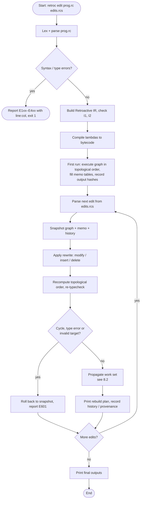
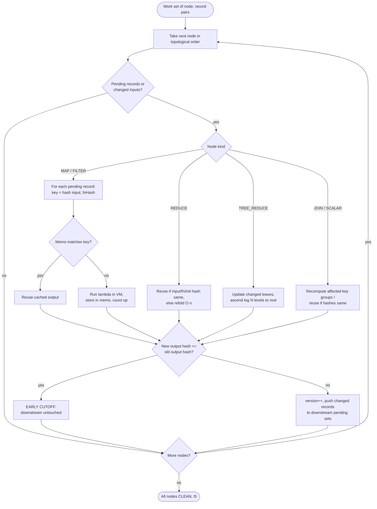
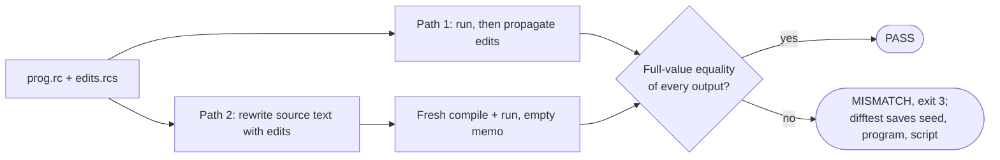

# RetroC: A Compiler and Runtime for Retroactively Editable Dataflow Pipelines

**Project Report**
Repository: `RetroC` · Language: C++17 · Build: CMake · Date: 28 October 2026

> **Abstract.** Data pipelines are routinely edited after they have run: a bad input record is corrected, a missing cleaning step is added in the middle, or an unneeded stage is removed. Today the usual answer is to rerun the whole pipeline. RetroC is a compiler and runtime for a small, pure dataflow language in which these three edits — *modify an input record*, *insert a stage*, *delete a stage* — are first-class operations on a versioned dataflow graph (the *Retroactive IR*). After each edit, RetroC recomputes only the records and stages whose inputs actually changed, using per-record memo tables and hash-based early cutoff, and it guarantees that the result is identical to a full rerun of the edited program. The system is about 9,800 lines of C++ across 11 modules, with 46 unit-test cases, golden tests for every compiler stage, and a randomized differential tester (1,000 trials) that checks every edit against a full rerun.

---

## Table of contents
1. [Title](#1-title)
2. [Existing solutions](#2-existing-solutions)
3. [Problem / gap](#3-problem--gap)
4. [Objectives](#4-objectives)
5. [Working principle](#5-working-principle)
6. [Detailed description](#6-detailed-description)
7. [System architecture](#7-system-architecture)
8. [Flowchart](#8-flowchart)
9. [Detailed module description](#9-detailed-module-description)
10. [Prototype / implementation](#10-prototype--implementation)
11. [Experimental setup](#11-experimental-setup)
12. [Results](#12-results)
13. [Performance / validation](#13-performance--validation)
14. [Screenshots / photographs](#14-screenshots--photographs)
15. [Novel features](#15-novel-features)
16. [Limitations and future work](#16-limitations-and-future-work)
17. [Conclusion](#17-conclusion)
18. [References](#18-references)

---

## 1. Title

**RetroC: A Compiler and Runtime for Retroactively Editable Dataflow Pipelines**

*Fine-grained, verified recomputation after modifying past inputs, inserting stages, and deleting stages in a pure dataflow language.*

---

## 2. Existing solutions

| Approach | Representative systems | How they handle a change | Shortcoming for retroactive edits |
|---|---|---|---|
| **Full batch rerun** | Python / Pandas scripts, SQL scripts, Spark batch jobs | Re-execute every stage on every record | Cost is proportional to the whole pipeline even when one record changes. |
| **Stage-level invalidation** | Make, Apache Airflow, Luigi, notebook re-execution (Observable, Pluto.jl) | Track dependencies between whole stages/files; rerun a stage and everything downstream when anything upstream changes | Granularity is the whole stage: one changed record forces every downstream stage to recompute all of its records. |
| **Incremental dataflow** | Differential Dataflow (McSherry et al., 2013), Naiad (Murray et al., 2013) | Propagate *differences* of input collections through a fixed dataflow graph | Excellent for input insert/delete, but the graph topology is fixed when the computation is built; inserting or deleting a stage means rebuilding the dataflow. |
| **Self-adjusting computation** | Adaptive Functional Programming (Acar, Blelloch, Harper, 2002), Selective Memoization (2003) | Record a dynamic dependency trace; change propagation re-executes affected parts | General-purpose, fine-grained; not specialized to collection pipelines or to structural edits of the program itself. |
| **Demand-driven incremental** | Adapton (Hammer et al., 2014) | Lazy, demand-driven dirtying and recomputation | Same: designed around changing inputs, not editing the program's stages. |
| **Query-based compilers / build systems** | Salsa, rustc incremental, "Build Systems à la Carte" (Mokhov et al., 2018) | Memoized queries with early cutoff | Early cutoff at the query/target level, not per record of a data collection. |
| **Retroactive data structures** | Demaine, Iacono, Langerman (2004/2007) | Insert/delete operations in the *past* of a data structure's history | Source of the term "retroactive"; applies to specific data structures, not to compiled pipelines. |

RetroC does **not** claim to invent memoization, change propagation, early cutoff, or the idea of retroactivity. It builds on these ideas (see Section 15 for exactly what is claimed).

---

## 3. Problem / gap

Three edits happen constantly while developing and maintaining data pipelines:

1. **A past input record is wrong.** Example: sensor reading 102 logged `-999.0` (a fault code) and must be corrected to `22.0`.
2. **A stage is missing.** Example: a +0.5 °C calibration step must be inserted *before* the Fahrenheit conversion.
3. **A stage is unnecessary.** Example: a temporary debugging or calibration stage must be removed.

**The gap.** Existing tools offer either *full or stage-level recomputation* (simple and correct, but wasteful — a one-record fix in a 100,000-record pipeline recomputes every record of every downstream stage) or *fine-grained incremental computation over a fixed graph* (efficient for input changes, but stage insertion/deletion is outside the model). There is no single system in which:

- input edits **and** structural stage edits are both first-class operations,
- reuse after an edit is tracked **per record**, not per stage,
- every edit comes with an explicit **rebuild plan** (what was recomputed, what was reused), and
- the result is **checked** against a from-scratch rerun of the edited program.

RetroC addresses exactly this gap for a small, pure dataflow language.

---

## 4. Objectives

| # | Objective | Status |
|---|---|---|
| O1 | Design a statically typed, **pure** dataflow language (`map`, `filter`, `reduce`, `join`, records, arrays, lambdas) with no mutation, I/O in lambdas, randomness or recursion. | Done |
| O2 | Build a full compiler front end: lexer, parser, semantic analysis with coded errors (E101–E601, each with line:col). | Done |
| O3 | Lower programs to a **versioned dataflow graph** (Retroactive IR) with stated invariants (I1–I9) and a canonical text dump. | Done |
| O4 | Compile lambda bodies to a **stack bytecode** and execute the graph while recording per-record memo tables and history. | Done |
| O5 | Implement the three retroactive edits — **modify input record, insert stage, delete stage** — as atomic graph rewrites with rollback on error. | Done |
| O6 | Propagate edits with **record-level reuse and early cutoff**, and print a **rebuild plan** and **provenance** (`explain`) for each edit. | Done |
| O7 | **Verify** that every edit result equals a full rerun of the edited program (verifier + 1,000-trial differential tester). | Done |
| O8 | **Benchmark** against full rerun (B0) and stage-level invalidation (B1) on four workloads, and report results honestly, including slowdowns. | Done (see Section 12) |
| O9 | Stretch: **incremental tree reduce** (`tree_reduce`) with O(log N) update for associative combiners. | Done |

---

## 5. Working principle

RetroC rests on one observation: **in a pure language, a stage's output for a record depends only on that record's input value and the stage's function.** So if both are unchanged, the old output can be reused without running the function.

The principle is applied in four steps:

1. **Remember.** On the first run, every `MAP`/`FILTER` stage stores, for every record, a memo entry
   `RecordId → (hash(input value), hash(function), output)`.
   `REDUCE`, `JOIN` and `SCALAR` nodes keep analogous memo data, and every node keeps a 64-bit hash of its whole output.
2. **Rewrite.** An edit is applied to the graph, not to text: modifying a record changes one input value; inserting a stage adds a node and rewires its consumer; deleting a stage rewires its consumers to its predecessor. The topological order is recomputed (Kahn's algorithm) and the graph is re-type-checked. Any failure rolls back to the snapshot taken before the edit (atomicity).
3. **Propagate.** Starting from a *work set* of affected (node, record) pairs, nodes are visited in topological order. For each pending record, if `(hash(input), fnHash)` matches the memo, the output is reused; otherwise the lambda is evaluated in the bytecode VM.
4. **Cut off early.** After a node is processed, its new output hash is compared with the old one. If it is unchanged, nothing downstream needs to run (**early cutoff**). If it changed, the node's version is incremented and only the changed records are pushed to downstream nodes.

**Correctness statement.** For any well-typed program *P*, input data *I*, and valid edit *e*:

> `Propagate(History(P, I), e)` produces exactly the same outputs as `Run(Apply(e, P), Apply(e, I))` from an empty memo.

*Proof sketch (induction on topological order):* the work set contains every record whose input value or stage function changed; a memo entry is reused only when both input hash and function hash match; because stages are pure, equal input and equal function give equal output; nodes not reached by the work set have unchanged inputs and functions. The only gap is hash collision, which the verifier closes by comparing full values, not just hashes.

---

## 6. Detailed description

### 6.1 The language

A RetroC program is a sequence of typed `input` declarations, `let` stages, optional single-expression `fn` helpers, and `output` declarations.

- **Types:** `int`, `float`, `bool`, `string`, arrays `[T]`, records `{ field: T, ... }`.
- **Builtins:** `map(c, x => e)`, `filter(c, x => b)`, `reduce(c, init, (acc, x) => e)`, `tree_reduce(c, init, (l, r) => e)`, `join(a, b, x => ka, y => kb)`, plus scalar helpers such as `length`, `to_float`.
- **Rules:** pure, no recursion (E402), no forward references (E401), no shadowing (E403); integer divide-by-zero is a runtime error (E501).

Example (the demo pipeline, `demo/pipeline.rc`):

```text
input sensor_readings: [{ id: int, temp_c: float, valid: bool }] = [
  { id: 101, temp_c: 21.5,   valid: true  },
  { id: 102, temp_c: -999.0, valid: false },
  { id: 103, temp_c: 24.0,   valid: true  },
  { id: 104, temp_c: 22.8,   valid: true  },
  { id: 105, temp_c: 23.2,   valid: true  }
];
let valid_readings = filter(sensor_readings, r => r.valid);
let temp_f  = map(valid_readings, r => r.temp_c * 1.8 + 32.0);
let sum_f   = reduce(temp_f, 0.0, (acc, t) => acc + t);
let count   = to_float(length(temp_f));
let avg_temp_f = sum_f / count;
output avg_temp_f;
```

### 6.2 The edit script language (`.rcs`)

```text
retro modify sensor_readings[1].temp_c = 22.0
retro modify sensor_readings[1].valid = true
retro insert before temp_f as calibrated : map(_, r => { id: r.id, temp_c: r.temp_c + 0.5, valid: r.valid })
retro delete calibrated
```

`_` stands for the collection the new stage will read. Edits apply in order and each receives an `EditId`.

| Edit | Precondition (otherwise E601, state rolled back) | Graph rewrite | Initial work set |
|---|---|---|---|
| **A. Modify** | input, record id and field exist; literal has the field's type | replace field value, rehash record | `{(input, RecordId)}` |
| **B. Insert** | target is not an INPUT; new lambda type-checks against the input element type; target still type-checks against the new output type | create node N, set `target.inputs[0] = N`, recompute topological order | every record of N (N has an empty memo) |
| **C. Delete** | stage is MAP/FILTER and removal type-checks; not the only producer of an OUTPUT | rewire consumers to the stage's input, remove node (NodeId never reused) | every record of each consumer, which then reuses memo entries whose input hash is unchanged |

### 6.3 The Retroactive IR

Each node has a stable `NodeId`, a kind (`INPUT`, `MAP`, `FILTER`, `REDUCE`, `TREE_REDUCE`, `JOIN`, `SCALAR`, `OUTPUT`), input edges, a function hash, an output hash, a version counter, a status, and a memo table. The graph keeps a topological order and an output list. Invariants checked by the implementation:

| Id | Invariant |
|---|---|
| I1 | The graph is a DAG and `order` is a valid topological order. |
| I2 | NodeIds are unique and never reused. |
| I3 | Node kind and function are never mutated in place (a memo entry is valid only for the function hash it was computed with). |
| I4 | A node's version increments if and only if its output hash changes. |
| I5 | After execution or propagation, every node is `CLEAN`. |
| I6 | Output and IR dumps are deterministic and byte-identical across runs; the graph type-checks after every edit. |
| I7 | A failed edit leaves graph, memo and history unchanged (transactional rollback). |
| I8 | Running with an empty memo gives the same result as running with a warm memo. |
| I9 | Provenance chains contain only edits that actually reached the output. |

### 6.4 Rebuild plan and provenance

Every edit prints a plan counting *operations* (lambda evaluations; a REDUCE counts one per element folded):

```text
Edit #1: retro modify rows[1].ok = true
Plan:
  clean      PARTIAL  evaluated      1 / 3       reused 2
  vals       PARTIAL  evaluated      1 / 3       reused 2  (early cutoff on unchanged inputs)
  sum        FULL     evaluated      3 / 3       (reduce is O(n) in v1)
  avg        FULL     evaluated      1 / 1
Recomputed: 6 ops   Reused: 4 ops   Full-rerun cost: 10 ops
Reuse: 40.0%   Updated outputs: avg
```

`retroc explain <output>` lists the edits that changed that output and the first stage each change entered.

### 6.5 Incremental tree reduce (stretch feature)

A linear `reduce` must refold every element after a changed one. For associative combiners, `tree_reduce` keeps a 1-indexed complete binary tree of size 2M (M = 2^⌈log₂N⌉) whose leaves are the records. Changing record *k* recomputes only the ⌈log₂N⌉ internal nodes on the path from leaf M+k to the root — 3 combiner steps for N = 8 (`demo/tree_demo.rc`) and 10 for N = 1,024 (unit test), instead of refolding the suffix.

---

## 7. System architecture

RetroC is organised as a strict layered pipeline: a module may only include modules to its left, so there are no dependency cycles.

```text
common ← lexer ← parser ← sema ← ir ← bytecode ← runtime ← edit ← reuse ← verify ← cli
```

```text
                    ┌──────────────────────── COMPILER FRONT END ────────────────────────┐
  program.rc  ───►  │  Lexer  ──►  Parser  ──►  Sema (types, scopes, purity)  ──►  IR Builder │
                    └─────────────────────────────────────────────────────────┬──────────┘
                                                                              │ Retroactive IR (versioned DAG)
                                                                              ▼
                                         ┌──────────── Bytecode compiler (lambda bodies) ───────────┐
                                         ▼                                                          │
                    ┌───────────── RUNTIME ─────────────┐                                           │
                    │ Graph executor + stack VM         │  first run: outputs, memo tables, history │
                    └───────────────┬───────────────────┘                                           │
                                    │                                                               │
  edits.rcs  ───►  Edit parser ──► Edit engine (graph rewrite, re-typecheck, snapshot/rollback) ◄───┘
                                    │
                                    ▼
                    Reuse analyzer + Propagator (work set, memo lookup, early cutoff, tree reduce)
                                    │
                 ┌──────────────────┼──────────────────────┐
                 ▼                  ▼                      ▼
           Updated outputs    Rebuild plan /         Verifier: source rewrite → fresh
                              explain (provenance)   compile + run → full-value compare
```

**Key data structures**

- `Value` — immutable tagged union (int, float, bool, string, record, array) with structural equality and a cached 64-bit structural hash; deterministic float formatting.
- `Collection` — ordered vector of `(RecordId, Value)`.
- `Node` / `Graph` — see Section 6.3.
- `Memo` — per node: MAP/FILTER `RecordId → {inHash, fnHash, out|keep}`; JOIN keyed by `(leftId, rightId)`; REDUCE `{inputHash, fnHash, initHash, result}`; TREE_REDUCE the array-based binary tree.
- `HistoryLog` — `{EditId, edit text, nodes touched, ops recomputed, ops reused, outputs changed}` per edit.

**CLI exit codes:** 0 ok, 1 compile error, 2 invalid edit, 3 verification mismatch, 4 runtime error.

---

## 8. Flowchart

### 8.1 End-to-end flow



### 8.2 Propagation with early cutoff



### 8.3 Verification flow



---

## 9. Detailed module description

Line counts are of `src/<module>/*.cpp` + `*.hpp` in the current repository.

| Module | Files | LOC | Responsibility | Key details |
|---|---|---|---|---|
| **common** | `value.*`, `error.hpp`, `location.hpp` | 347 | Shared values, errors, source locations | Tagged immutable `Value`, structural equality and 64-bit hashing, deterministic float printing; error type carrying code + line:col + message. |
| **lexer** | `lexer.*`, `token.*` | 397 | Source text → tokens | All token kinds, `//` comments, int vs float literals, string escapes; errors E101 (bad string/escape), E102 (unexpected char). `retroc dump-tokens`. |
| **parser** | `parser.*`, `ast.*` | 1,208 | Tokens → AST | Recursive descent with an operator-precedence table and lookahead to tell lambdas `(a, b) => e` from parenthesised expressions; E201 syntax errors; `retroc dump-ast`. |
| **sema** | `sema.*`, `types.*` | 901 | Type checking and scoping | Symbol table with sequential stage scoping; lambda parameter type inference from builtin signatures; join key types; rejects recursion (E402), forward refs (E401), shadowing (E403), type errors (E301–E304). `retroc check`. |
| **ir** | `graph.*`, `node.*`, `builder.*`, `expr_ir.*`, `dump.*` | 1,611 | Typed AST → Retroactive IR | Inlines user `fn`s; splits nested builtins into hidden stages (`s$1`, `s$2`); node memo structures; Kahn topological sort (`recompute_topological_order`); invariant checks I1/I2; canonical `retroc dump-ir`. |
| **bytecode** | `bytecode.*` | 835 | Lambda/expression bodies → stack bytecode + VM | Compact instruction set; `FixedVMStack` with a 64-slot inline buffer and overflow spill so ordinary expressions never allocate, while large array literals still work. |
| **runtime** | `executor.*`, `csv.*`, `history.hpp` | 828 | Executes the graph | Graph executor for every node kind, memo filling, output hashing, history log and memory accounting, CSV loader (written in-house, no dependency). `retroc run [--verbose]`. |
| **edit** | `edit.*`, `source_rewrite.*` | 764 | Edit scripts | Parser for `.rcs` (reuses the expression parser); validation of preconditions; **source rewriting** that produces the edited program text, used by the verifier. |
| **reuse** | `propagator.*` | 2,067 | Heart of the system | Applies modify/insert/delete as graph rewrites with snapshot + rollback; work-set propagation; memo lookup; early cutoff; tree-reduce path update; rebuild plan; provenance and `retroc explain`. |
| **verify** | `verifier.*` | 277 | Correctness check | Runs propagated path and full-rerun path on rewritten source; compares outputs by full structural `Value` equality (not only hashes). `retroc verify`. |
| **cli** | `main.cpp` | 544 | Driver | Subcommands `dump-tokens`, `dump-ast`, `check`, `dump-ir`, `run`, `edit`, `verify`, `explain`; consistent exit codes. |

**Supporting tools**

| Tool | Location | Purpose |
|---|---|---|
| `unit_tests` | `tests/unit/` (doctest) | 46 test cases: lexer 7, parser 4, sema 3, IR 3, runtime 11, edit 13, tree reduce 4, sanity 1. |
| Golden runners | `tests/golden/<stage>/runner.py` | Exact-output tests for lexer, parser, sema, IR, run, edit (incl. `explain`). |
| `difftest` | `tests/diff/runner.cpp` | Random well-typed programs (3–8 stages), random data, random 1–6-edit scripts; plus an invalid-edit pass per trial. Saves failures to `tests/diff/failures/<seed>/`. |
| `gen_workload`, `bench_runner` | `bench/` | Seeded workload generator (W1–W4) and B0/B1/B2 benchmark harness. |

---

## 10. Prototype / implementation

**Technology.** C++17, CMake, doctest (single header), Python 3 for golden-test runners. No other third-party dependencies (the CSV parser is written in-house). Warnings are errors (`-Wall -Wextra -Werror`); test builds use `-O0 -g -fsanitize=address,undefined`; benchmark builds use `-O2`.

**Size.** ≈ 9,780 lines of C++ in `src/`, ≈ 2,940 lines in `tests/` and `bench/`.

**Development process.** The system was built in 13 phases, each closed only when its tests passed:

| Phase | Deliverable |
|---|---|
| 0 | Repository, CMake, CLI stub, spec freeze |
| 1 | Lexer + `dump-tokens` |
| 2 | Parser + AST + `dump-ast` |
| 3 | Semantic analysis + `check` |
| 4 | IR builder + canonical dump |
| 5 | Bytecode VM + runtime (from-scratch execution) |
| 6 | Memo tables + history recording |
| 7 | Edit A (modify) propagation + verifier + first differential tester |
| 8 | Edit B (insert) and Edit C (delete) with topological reordering and rollback |
| 9 | Rebuild plan + `explain` provenance |
| 10 | Hardened verifier (full-value equality) + invalid-edit fuzzing |
| 11 | Benchmarks (B0/B1/B2 on W1–W4) |
| 12 | Stretch: incremental `tree_reduce` |
| Final | Report, README, demos |

**Build and run**

```bash
cmake -B build -DCMAKE_BUILD_TYPE=Release
```

```bash
cmake --build build --config Release
```

```bash
ctest --test-dir build --output-on-failure
```

```bash
build/retroc edit demo/pipeline.rc demo/edits.rcs
```

Demo launchers: `demo/run_demo.bat` / `demo/run_demo.sh` (fast automated demo) and `demo/prof_demo.bat` / `demo/prof_demo.ps1` (step-by-step presentation demo, with talking points in `demo/DEMO_WALKTHROUGH.md`).

---

## 11. Experimental setup

### 11.1 Environment
- OS: Windows 11; toolchain: MinGW-w64 UCRT64, GCC 15.2.0, CMake 4.4.4.
- Release build, `-O2`; single-threaded, deterministic execution.
- Seeded data generators (`bench/gen_workload`).
- Protocol in `bench/runner.cpp`: 1 warm-up run + 3 measured runs per scenario, with 10 edits per batch for multi-record scenarios (reduced from the spec's 3 warm-ups + median of 11 to keep total runtime under ~2 minutes; decision D-010 in `MEMORY.md`). CPU model and RAM were not recorded in the results.

### 11.2 Workloads

| ID | Description | Size | Pipeline |
|---|---|---|---|
| W1 | Sensor log | 100,000 records | filter valid → map normalize → map scale → filter range → reduce sum → scalar avg |
| W2 | Orders/users join | 50k users, 200k orders | join → map amount → filter → reduce |
| W3 | Deep pipeline | 100,000 records | 12 chained map/filter stages + reduce |
| W4 | Reduce-heavy | 100,000 ints (spec: 1M) | map → reduce |

### 11.3 Edit scenarios

| ID | Edit |
|---|---|
| E-A | modify 1 input record |
| E-B | modify a batch of input records (10 records spread across the input) |
| E-C | insert a map near the pipeline start |
| E-D | insert a map near the pipeline end |
| E-E | delete a middle stage |

### 11.4 Systems compared

| ID | System |
|---|---|
| **B0** | Full rerun of the edited program from scratch |
| **B1** | Stage-level invalidation: same runtime, but any change to a node's input recomputes the whole node |
| **B2** | RetroC: record-level memo + early cutoff |

### 11.5 Metrics
Wall time (ms), operations recomputed vs reused (reuse % = reused / (recomputed + reused)), speedup B0/B2, first-run overhead of history recording, memo memory, and a `verify` PASS/FAIL for every benchmark run.

---

## 12. Results

### 12.0 Update (28 Oct 2026): incremental propagation

After review, propagation was rewritten so that work follows the changed records rather than the collection size (Section 13.4 describes the change). The B1 baseline was also found to be unimplemented: the stage-invalidation flag was stored but never read, so the old B1 column in 12.1 actually measured B2. B1 now really recomputes whole stages.

Same machine, same benchmark runner and protocol before and after (1 warm-up + median of 3 timed runs). Speedup = B0 / B2:

| Scenario | Before | After (run 1) | After (run 2) |
|---|---|---|---|
| W1 E-A modify 1 record (100k) | 1.28× | **5.78×** | **5.06×** |
| W1 E-B modify 10 records | 0.29× | 1.26× | 1.30× |
| W1 E-C insert near start | 0.30× | 1.01× | 1.03× |
| W1 E-D insert near end | 1.31× | **4.90×** | **5.51×** |
| W1 E-E delete middle stage | 0.86× | 2.15× | 2.24× |
| W2 E-A join, modify 1 | 0.22× | 0.20× | 0.22× |
| W3 E-C insert near start | 0.58× | 2.11× | 0.85× (inconclusive) |
| W4 E-A modify 1 | 1.34× | 3.32× | 3.44× |

With B1 now real, fine-grained reuse beats stage-level invalidation on single-record edits (W1 E-A, B1/B2 = 5.80× and 8.97×; W1 E-B, 9.52× and 9.71×). Every run passed `verify`. Absolute times varied by up to 3× between the two runs on this machine, so only ratios that held in both runs are claimed. Joins (W2) are unchanged: JOIN still recomputes in full and renumbers its output. Edits that touch every record (W1 E-C) now break even instead of losing 3×. The full protocol (median of 11, all scenarios, 10k/1M scaling) is the next step.

### 12.1 Benchmark results before the update (from `docs/BENCHMARKS.md`, Phase 11 run; B1 column invalid, see 12.0)

| Workload | Edit | B0 ms | B1 ms | B2 ms | Speedup B0/B2 | Reuse % | Verify |
|---|---|---|---|---|---|---|---|
| W1 | E-A modify 1 record | 745.69 | 555.90 | 526.70 | **1.42×** | 83.2% | PASS |
| W1 | E-B modify batch | 686.46 | 4762.16 | 4639.51 | 0.15× | 100.0% | PASS |
| W1 | E-C insert near start | 815.34 | 1207.21 | 1173.87 | 0.69× | 0.0% | PASS |
| W1 | E-D insert near end | 767.99 | 590.31 | 701.54 | **1.09×** | 50.0% | PASS |
| W1 | E-E delete middle stage | 554.50 | 661.84 | 653.24 | 0.85× | 0.5% | PASS |
| W2 | E-A modify 1 order | 30.58 | 149.03 | 148.99 | 0.21× | 48.0% | PASS |
| W3 | E-C insert near start | 2040.00 | 3942.37 | 4047.10 | 0.50× | 0.0% | PASS |
| W4 | E-A modify 1 record | 186.23 | 133.24 | 122.35 | **1.52×** | 50.0% | PASS |

### 12.2 First-run overhead

| Workload | First run plain | First run with history + memo | Overhead | Memo size | Input size |
|---|---|---|---|---|---|
| W1 | 684.01 ms | 767.84 ms | **12.3 %** | 36.18 MB | 1.73 MB |

### 12.3 Operation-count results (exact, from golden tests)

| Case | Recomputed ops | Reused ops | Full-rerun ops | Reuse |
|---|---|---|---|---|
| Ex2, `modify rows[1].ok = true` | 6 | 4 | 10 | 40.0 % |
| Ex2, insert `scaled` map before `vals` | 10 | 0 | 10 | 0.0 % |
| Ex2, delete `scaled` | 7 | 0 | 7 | 0.0 % |
| `tree_reduce`, N = 8, modify 1 element | 3 combiner steps | — | 8 | — |
| `tree_reduce`, N = 1,024, modify 1 element | 10 combiner steps | — | 1,024 | — |

### 12.4 Interpretation

- **Where RetroC wins.** Single-record edits where most records are untouched: W1 E-A (1.42×, 83 % of operations reused), W4 E-A (1.52×), and a late insert W1 E-D (1.09×). Every run produced the same result as a full rerun.
- **Where RetroC loses.** Edits that touch most of the data (insert near the start, W1 E-C/W3 E-C: 0 % reuse, so all bookkeeping is pure overhead), batch modifies (W1 E-B), and the join workload (W2), where per-record memo maintenance costs more than recomputing. In these cases B1 is equally slow, showing the cost is in the propagation machinery, not in the granularity choice.
- **Reuse is high but time savings are smaller.** The current wall-time includes memo hashing, work-set maintenance and snapshotting for rollback; at this scale those constant costs eat most of the savings from skipped lambda calls. The linear `reduce` (O(n) after any change) also caps the gain for pipelines ending in a fold — exactly what `tree_reduce` addresses.
- **Overhead of remembering** is moderate in time (12.3 %) but large in memory (memo ≈ 21× the input size on W1).

These numbers are for this mini-language on one machine; they are not a general performance claim.

> **Note on other figures in the repository.** `README.md`, `REPORT.md` and `FINAL_REVIEW_REPORT.md` quote a different table (up to 10.9× speedup, >80 % reuse, 1.15× overhead) with workload definitions (e.g. W2 "branching pipeline", W3 "two-table join", 10k records) that do not match `bench/runner.cpp` or `docs/BENCHMARKS.md`, and no result files for that table exist in `bench/`. This report uses only the `docs/BENCHMARKS.md` figures, which match the benchmark code. Those other documents should be corrected or the benchmark re-run before submission.

---

## 13. Performance / validation

### 13.1 Correctness evidence

| Check | Method | Result recorded in project log |
|---|---|---|
| Unit tests | doctest, 46 test cases | 46/46 pass, 549 assertions |
| Golden tests | exact output diff for lexer, parser, sema, IR, run, edit, explain | all pass |
| Differential testing | `difftest`, seeds 1..1000: random program + data + 1–6 edits (60 % modify, 20 % insert, 20 % delete); full-value comparison with a fresh rerun of the rewritten source | **1,000 / 1,000 trials pass** |
| Invalid-edit robustness | per trial, generate invalid edits (bad RecordId, bad field, illegal insert/delete); require E601 and byte-identical state afterwards | all rejected, state unchanged |
| Metamorphic test | insert identity map `x => x` → outputs unchanged, downstream fully reused | pass |
| Memo transparency (I8) | empty-memo run vs warm-memo run | identical |
| Determinism (I6) | run goldens twice, byte-compare | identical |
| Benchmarks | `verify` on every benchmark scenario | 8/8 PASS |
| Sanitizers | ASan + UBSan available via `-DRC_SANITIZE=ON` | not run: MinGW GCC ships no libasan/libubsan (needs a clang or Linux build) |

CTest summary recorded at the end of the final phase (`MEMORY.md`, 27 Oct 2026):

```text
unit_tests ........ Passed (46 test cases, 549 assertions)
golden_tests_lexer  Passed
golden_tests_parser Passed
golden_tests_sema . Passed
golden_tests_ir ... Passed
golden_tests_run .. Passed
golden_tests_edit . Passed
diff_tests ........ Passed (1,000 randomized trials)
100% tests passed out of 8
```

*(No C++ toolchain was available on the machine where this report was written, so the suite was not re-run for this document; re-run `ctest` before the final submission and paste the fresh output here.)*

### 13.2 Worked validation example

For Ex2 with `retro modify rows[1].ok = true` the hand-computed plan is: `clean` re-evaluates 1 record, `vals` 1 record, `sum` refolds 3 elements, `avg` 1 op — 6 recomputed, 4 reused, 10 for a full rerun — and the new output is `avg = (2.0 + 5.0 + 4.0) / 3 = 3.6666666666666665`. The golden test `tests/golden/edit/ex2_three_edits.expected` matches these numbers exactly.

### 13.4 What changed in propagation (28 Oct 2026)

| Old cost per edit | Cause | Fix |
|---|---|---|
| O(n) per visited MAP/FILTER | every record re-hashed and looked up even if one changed | patch only pending records (binary search by RecordId); one full pass only when > 1/8 of records are pending |
| O(n) per visited stage | order-dependent collection hash recomputed from scratch | commutative hash: size + sum of mix(RecordId, value hash), updated in O(1) per changed record |
| O(n) copy per visited stage | whole collection copied into `stage_values` | collections stored only if an expression reads them (size only when read via `length`) |
| O(memo) per insert/delete | graph, results and memo tables cloned for rollback | undo the exact rewiring instead |
| over-propagation | consumers received every re-evaluated record | consumers receive only records whose output actually changed |

Validation after the change: 8/8 CTest suites, 52 unit-test cases (687 assertions; 6 new cases in `tests/unit/test_incremental.cpp` check per-stage op counts, hash consistency, early cutoff, B1 and insert/delete reuse), and 10,000 differential trials across 5 seeds. The differential generator was extended from 3 to 6 pipeline shapes (filter chains, branching + `tree_reduce`, join) and from 5–24 to 5–200 records. To check that these tests can catch real mistakes, a deliberately planted bug (dropping one changed-record report) was caught at trial 16.

**Known open bug (found during this work, pre-existing).** A lambda that reads another stage, e.g. `map(xs, x => x + total)`, does not record that stage as an input, and the memo key ignores it. After a modify that changes `total`, cached records keep the old value (`retroc verify`: `[25, 8, 9]` vs rerun `[25, 17, 18]`). The original code fails the same way. Fixing it requires a change to `IR_SPEC.md`.

### 13.3 Performance summary

| Question | Answer from measurements |
|---|---|
| Does RetroC always give the full-rerun result? | Yes on every test, golden case, benchmark run and 1,000 random trials. |
| Does it save work? | Yes. After the 28 Oct update, wall time follows the operation counts on localized edits: about 5–6× on a one-record W1 edit, 2.2× for a middle delete, 3.3× on W4. |
| When is it slower? | Joins (W2, ≈0.2×). Edits that change every record now break even (≈1.0×) instead of losing up to 3×. |
| Cost of remembering? | +12.3 % first-run time; memo ≈ 21× input size on W1. |
| Tree reduce? | O(log N): 3 steps for N = 8, 10 for N = 1,024. |

---

## 14. Screenshots / photographs

The figures below are the program's actual outputs, taken from the golden test files the test suite checks byte-for-byte. Screen captures of the same commands should be inserted at the marked places for the printed report.

**Figure 1 — IR dump (`retroc dump-ir tests/golden/ir/ex1.rc`)**

```text
n0 INPUT  xs    : [int]
n1 FILTER evens : [int] <- n0  fn: x => x % 2 == 0
n2 MAP    sq    : [int] <- n1  fn: x => x * x
n3 REDUCE total : int <- n2  init: 0  fn: (a, x) => a + x
n4 OUTPUT sq    : [int] <- n2
n5 OUTPUT total : int <- n3
```

**Figure 2 — Three retroactive edits with rebuild plans (`retroc edit tests/golden/edit/ex2_three_edits.rc tests/golden/edit/ex2_three_edits.rcs`)**

```text
Edit #1: retro modify rows[1].ok = true
Plan:
  clean      PARTIAL  evaluated      1 / 3       reused 2
  vals       PARTIAL  evaluated      1 / 3       reused 2  (early cutoff on unchanged inputs)
  sum        FULL     evaluated      3 / 3       (reduce is O(n) in v1)
  avg        FULL     evaluated      1 / 1
Recomputed: 6 ops   Reused: 4 ops   Full-rerun cost: 10 ops
Reuse: 40.0%   Updated outputs: avg
Edit #2: retro insert before vals as scaled : map(_, r => { id : r . id , v : r . v * 2.0 , ok : r . ok })
Plan:
  scaled     NEW      evaluated      3 / 3
  vals       FULL     evaluated      3 / 3
  sum        FULL     evaluated      3 / 3       (reduce is O(n) in v1)
  avg        FULL     evaluated      1 / 1
Recomputed: 10 ops   Reused: 0 ops   Full-rerun cost: 10 ops
Reuse: 0.0%   Updated outputs: avg
Edit #3: retro delete scaled
Plan:
  vals       FULL     evaluated      3 / 3
  sum        FULL     evaluated      3 / 3       (reduce is O(n) in v1)
  avg        FULL     evaluated      1 / 1
Recomputed: 7 ops   Reused: 0 ops   Full-rerun cost: 7 ops
Reuse: 0.0%   Updated outputs: avg
avg = 3.6666666666666665
```

**Figure 3 — Provenance (`retroc explain ... avg`)**

```text
Explain avg:
  Edit #1: retro modify rows[1].ok = true
    first stage: rows
    recomputed:  6 ops, reused: 4 ops
  Edit #2: retro insert before vals as scaled : map(...)
    first stage: scaled
    recomputed:  10 ops, reused: 0 ops
  Edit #3: retro delete scaled
    first stage: vals
    recomputed:  7 ops, reused: 0 ops
```

**Screen captures to insert (commands to run)**

| Fig. | What to capture | Command |
|---|---|---|
| 4 | Build output with no warnings | `cmake --build build --config Release` |
| 5 | CTest summary, 8/8 passed | `ctest --test-dir build --output-on-failure` |
| 6 | Sensor-log demo: first run, 3 edits, verify PASS, explain | `demo\run_demo.bat` |
| 7 | Presentation demo walkthrough | `demo\prof_demo.bat` |
| 8 | `tree_reduce` demo showing 3 combiner steps for N = 8 | `build\retroc edit demo\tree_demo.rc demo\tree_demo.rcs` |
| 9 | A rejected edit (E601) with unchanged outputs | an `.rcs` with an out-of-range RecordId |
| 10 | Benchmark table printed by the runner | `build\bench_runner` |

---

## 15. Novel features

What is **not** new (and not claimed): dependency-graph change propagation, memoization, early cutoff, and the term "retroactive".

What RetroC contributes, with the evidence for each:

| # | Feature | Why it is distinctive | Evidence |
|---|---|---|---|
| N1 | **Structural edits as first-class compiler operations.** Stage *insert* and *delete* sit beside input *modify* as typed, atomic rewrites of a versioned IR, each re-type-checked and rolled back on failure. | Incremental dataflow systems fix the graph topology up front; RetroC edits the topology of a live, already-executed computation. | IR invariants I1–I9, edit semantics, `test_edit.cpp`, difftest (40 % of generated edits are structural). |
| N2 | **Record-level reuse across structural edits.** After an insert or delete, downstream stages reuse memo entries per record via `(inputHash, fnHash)` keys and early cutoff on output hashes. | Stage-level tools (B1) recompute the whole downstream stage. | Reuse % in Section 12 (e.g. 50 % on W1 E-D vs B1 recomputing all). |
| N3 | **Explainable recomputation.** Every edit prints a rebuild plan (per-stage evaluated / reused, full-rerun cost) and `explain` traces which edits actually changed an output — edits absorbed by early cutoff are excluded. | Most incremental engines are opaque about what they recomputed. | Golden tests `ex2_three_edits.expected` / `.explain.expected`. |
| N4 | **Built-in equivalence verifier.** `retroc verify` rewrites the *source text* with the edits, compiles and runs it fresh, and compares full values with the propagated result. | Correctness is checked end-to-end on every edit, not assumed. | 1,000/1,000 differential trials; verify PASS on all benchmarks. |
| N5 | **Transactional edits.** Snapshot + rollback guarantees invalid edits (bad ids, type-breaking insert/delete, cycles) leave graph, memo and history byte-identical. | Prevents half-applied edits from corrupting cached state. | Invalid-edit pass in every difftest trial. |
| N6 | **Incremental tree reduce.** O(log N) update for associative folds instead of O(N). | Removes the main bottleneck of linear reductions after an edit. | `test_tree_reduce.cpp`; 10 steps for N = 1,024. |
| N7 | **Allocation-free expression VM.** `FixedVMStack` keeps a 64-slot inline buffer with overflow spill. | Keeps per-record lambda evaluation cheap without limiting expression size. | `test_tree_reduce.cpp` builds and runs a 1,024-element array literal. |

---

## 16. Limitations and future work

**Limitations (current version)**
- Linear `reduce` is O(n) after any change (use `tree_reduce` when the combiner is associative).
- Stages can be inserted or deleted but not replaced in one edit; no record insert/delete on inputs; no control-flow edits.
- Wall-time gains appear on localized edits; joins are still slower than a full rerun, and edits that change every record only break even.
- A lambda that reads another stage is not tracked as a dependency (open bug, Section 13.4).
- Sanitizer runs (ASan/UBSan) are not possible with the MinGW GCC toolchain used.
- Memo memory is large (≈ 21× input on W1). Single-threaded, in-memory only.
- Benchmarks used 3 measured runs instead of the planned median of 11, and the machine's CPU/RAM were not recorded.

**Future work**
1. A **cost model** that predicts the fraction of records an edit will change and falls back to full stage recomputation when incremental work would be slower (directly targets W1 E-B/E-C, W3 E-C).
2. Cheaper bookkeeping: avoid full snapshots for rollback, compact memo entries.
3. Record insert/delete on inputs, stage replacement, control-flow edits.
4. Comparison with an established incremental system (e.g. Differential Dataflow) on modify-input edits.
5. Disk-backed memo store and parallel/distributed execution.

---

## 17. Conclusion

RetroC shows that modifying past inputs, inserting stages and deleting stages can be handled as typed, atomic, first-class operations of a compiler for a pure dataflow language, with recomputation tracked per record and every result checked against a full rerun. Correctness was confirmed across unit, golden, metamorphic and 1,000 randomized differential tests. Performance is reported as measured. After propagation was made proportional to the changed records, a one-record edit on a 100,000-record pipeline runs about 5–6× faster than a full rerun, and fine-grained reuse beats real stage-level invalidation by 6–10× on single-record edits. Joins remain slower than a rerun, and edits that change every record only break even, which makes a recompute-vs-patch cost model the clear next step.

---

## 18. References

1. E. D. Demaine, J. Iacono, S. Langerman. *Retroactive Data Structures.* SODA 2004; ACM Transactions on Algorithms, 2007.
2. U. A. Acar, G. E. Blelloch, R. Harper. *Adaptive Functional Programming.* POPL 2002.
3. U. A. Acar, G. E. Blelloch, R. Harper. *Selective Memoization.* POPL 2003.
4. U. A. Acar. *Self-Adjusting Computation.* PhD thesis, Carnegie Mellon University, 2005.
5. M. A. Hammer et al. *Adapton: Composable, Demand-Driven Incremental Computation.* PLDI 2014.
6. F. McSherry, D. G. Murray, R. Isaacs, M. Isard. *Differential Dataflow.* CIDR 2013.
7. D. G. Murray et al. *Naiad: A Timely Dataflow System.* SOSP 2013.
8. Y. Cai, P. G. Giarrusso, T. Rendel, K. Ostermann. *A Theory of Changes for Higher-Order Languages.* PLDI 2014.
9. A. Mokhov, N. Mitchell, S. Peyton Jones. *Build Systems à la Carte.* ICFP 2018.
10. Salsa (incremental computation framework) and the rustc incremental compilation design.

*(Per `docs/PRIOR_WORK.md`, verify each citation's authors, venue and year against the original source and add DOIs before submission.)*
